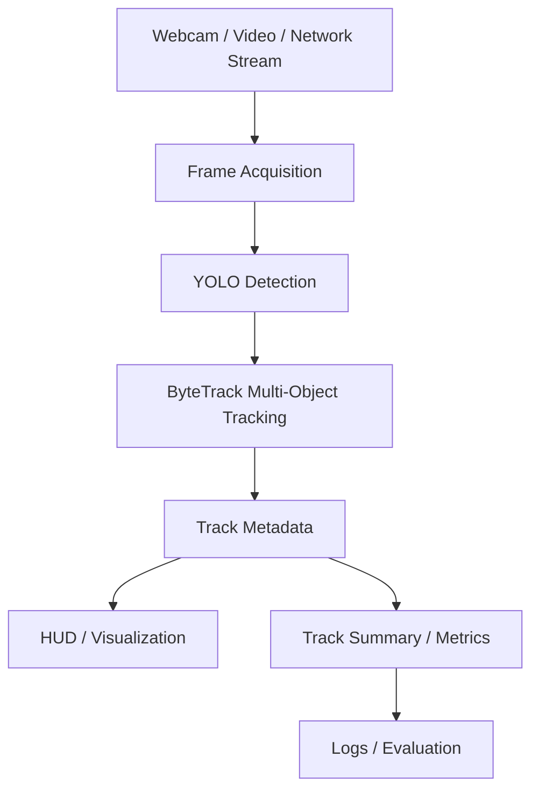

# Aerial Surveillance Architecture

## Data flow

1. **Frame acquisition** accepts local or network-based video sources.
2. **Detection** produces class, confidence, and box metadata.
3. **Tracking** associates detections across frames using persistent IDs.
4. **Track metadata** feeds visualization and summary logic.
5. **Metrics** report active tracks and inference performance.

## Edge deployment

The public code is intentionally hardware-agnostic. On NVIDIA Jetson or Raspberry Pi-class devices, model format, decoder path, image size, and source handling should be selected for the actual hardware and camera pipeline.

## Privacy / IP boundaries

This repository does not contain private surveillance footage, customer streams, credentials, proprietary model weights, or internal company source.
